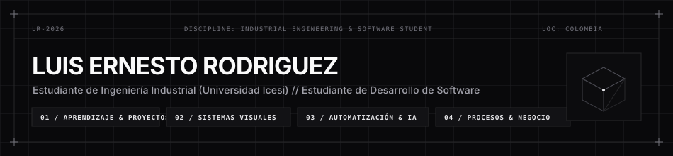
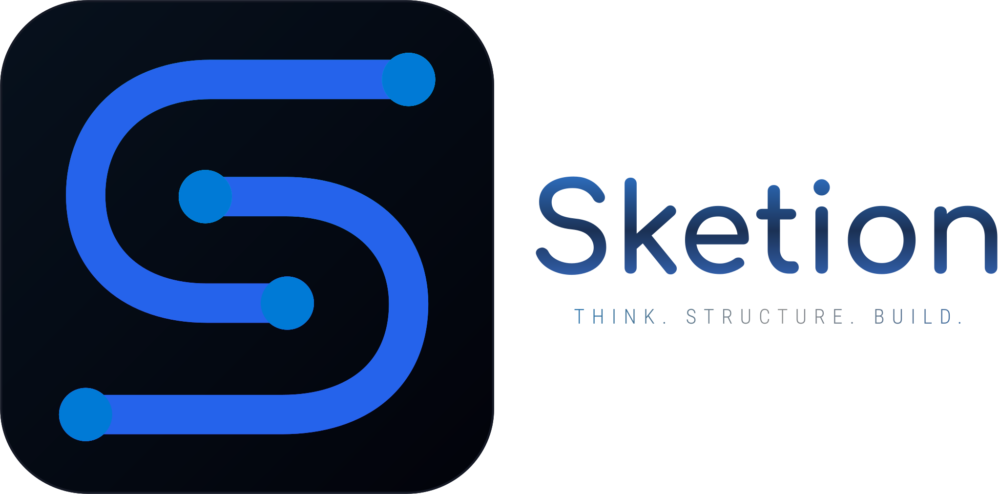
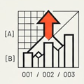

<div align="center">
  
</div>

<br/>

<div align="center">
  <!-- Barra de Navegación & Conversión Rápida -->
  <a href="https://sketion.com">
    
  </a>&nbsp;
  <a href="https://luisrodriguez-rgb.github.io/GITHUB_SNAKE.EXE/">
    
  </a>&nbsp;
  <a href="mailto:luisrodriguez@itipopayan.edu.co">
    
  </a>&nbsp;
  <a href="https://github.com/luisrodriguez-rgb">
    
  </a>
</div>

<br/>

---

### `00 // ARQUITECTURA & PERFIL`

> **Ingeniería Industrial (Universidad Icesi) × Desarrollo de Software & Arquitectura de Sistemas.**

Diseño y construyo **herramientas para desarrolladores, motores deterministas y productos SaaS** donde la optimización matemática se une con la ingeniería de software de alto rendimiento.

En lugar de limitarme a interfaces convencionales, me gusta resolver problemas complejos de flujo de trabajo: **espacios visuales de conocimiento local-first, motores de diagramación algorítmica, sistemas de decisión multicriterio (MCDA) y simulaciones interactivas en tiempo real**. Participo en el ciclo completo del producto: desde la formulación matemática y la arquitectura limpia hasta el diseño editorial en UI y el despliegue en producción.

---

### `01 // SISTEMAS INSIGNIA (PINNED REPOSITORIES)`

<table>
  <tr>
    <!-- PROYECTO 01: SKETION -->
    <td width="50%" valign="top">
      <h4>
        
        &nbsp; <code>01 // SKETION</code>
      </h4>
      <p><strong>Visual Knowledge Workspace & Systems Modeling</strong></p>
      <p>Entorno visual de alto rendimiento diseñado para estructurar conocimiento técnico, modelar arquitecturas y documentar ingeniería. Unifica lectura de PDFs, renderizado matemático en <strong>LaTeX</strong>, diagramación <strong>Mermaid</strong>, pipelines de datos y notas Markdown sobre un lienzo infinito con persistencia <em>local-first</em>.</p>
      <p>
        <code>React</code> <code>Next.js</code> <code>TypeScript</code> <code>Canvas API</code> <code>LaTeX / Mermaid</code>
      </p>
      <p>
        <a href="https://sketion.com">
          
        </a>
        <a href="https://sketion.vercel.app">
          
        </a>
        <a href="https://docs-sketion.vercel.app">
          
        </a>
        <a href="https://github.com/luisrodriguez-rgb/Sketion">
          
        </a>
      </p>
    </td>
    <!-- PROYECTO 02: SKETION DIAGRAM DESIGN ENGINE -->
    <td width="50%" valign="top">
      <h4>
        
        &nbsp; <code>02 // SKETION DIAGRAM ENGINE</code>
      </h4>
      <p><strong>Motor Algorítmico de Diseño y Generación de Diagramas</strong></p>
      <p>Motor visual que transforma estructuras de datos, esquemas técnicos y prompts en diagramas de arquitectura listos para producción. Automatiza decisiones deterministas de <strong>jerarquía espacial, enrutamiento ortogonal, balance de composición y legibilidad tipográfica</strong> en SVG.</p>
      <p>
        <code>Python</code> <code>TypeScript</code> <code>React</code> <code>SVG Engine</code> <code>Spatial Algorithms</code>
      </p>
      <p>
        <a href="https://github.com/luisrodriguez-rgb/Sketion-Diagram-Design-Engine-">
          
        </a>
        <a href="https://sketion.com">
          
        </a>
      </p>
    </td>
  </tr>
  <tr>
    <!-- PROYECTO 03: AXIS-TOOLMAP -->
    <td width="50%" valign="top">
      <h4>
        
        &nbsp; <code>03 // AXIS (TOOLMAP)</code>
      </h4>
      <p><strong>Motor de Decisión Multicriterio (MCDA) para Stacks Técnicos</strong></p>
      <p>Sistema de evaluación determinista para arquitectos de software e ingenieros. Permite modelar, ponderar y auditar decisiones sobre stacks tecnológicos y flujos de trabajo analizando <em>trade-offs</em> reales (costo, latencia, escalabilidad, fricción operativa) bajo rigor matemático y diseño editorial suizo.</p>
      <p>
        <code>TypeScript</code> <code>Vite</code> <code>MCDA Models</code> <code>Decision Matrix</code> <code>Local-First</code>
      </p>
      <p>
        <a href="https://github.com/luisrodriguez-rgb/AXIS-TOOLMAP">
          
        </a>
      </p>
    </td>
    <!-- PROYECTO 04: GITHUB_SNAKE.EXE -->
    <td width="50%" valign="top">
      <h4>
        
        &nbsp; <code>04 // GITHUB_SNAKE.EXE</code>
      </h4>
      <p><strong>Simulador Canvas 2D a 60 FPS & IA de Navegación Autónoma</strong></p>
      <p>Emulador interactivo que convierte la matriz de contribuciones de GitHub en un motor de juego de precisión. Integra <strong>interpolación LERP (Zero-Flicker)</strong>, piloto automático con pathfinding híbrido <strong>BFS + heurística Flood Fill</strong> para evitar callejones sin salida, modo duelo IA vs jugador, sintetizador <strong>Web Audio API</strong>, exportador de scripts de <em>Commit Art</em> y <strong>GitHub Action</strong> propia que anima tu perfil.</p>
      <p>
        <code>Vanilla JS (ES6+)</code> <code>HTML5 Canvas 2D</code> <code>BFS + Flood Fill AI</code> <code>Web Audio API</code>
      </p>
      <p>
        <a href="https://luisrodriguez-rgb.github.io/GITHUB_SNAKE.EXE/">
          
        </a>
        <a href="https://github.com/luisrodriguez-rgb/GITHUB_SNAKE.EXE">
          
        </a>
      </p>
    </td>
  </tr>
</table>

---

### `02 // TELEMETRÍA DE CONTRIBUCIONES & AUTOMATIZACIÓN`

<div align="center">
  <a href="https://perfila-lr.vercel.app/?u=luisrodriguez-rgb">
    <picture>
      <source media="(prefers-color-scheme: dark)" srcset="https://perfila-lr.vercel.app/api/kit/luisrodriguez-rgb.svg?theme=ink&lang=es">
      
    </picture>
  </a>
  <picture>
    <source media="(prefers-color-scheme: dark)" srcset="https://perfila-lr.vercel.app/api/luisrodriguez-rgb.svg?theme=ink&lang=es">
    
  </picture>
</div>


---
---

### `03 // ROADMAP DE INGENIERÍA [2026]`

```diff
+ [EN PRODUCCIÓN] Escalado del ecosistema visual Sketion (Workspace & Diagram Design Engine).
+ [ACTIVO]        Modelado de motores deterministas y sistemas de evaluación de arquitecturas (AXIS / MCDA).
! [EN CURSO]      Profundización en Arquitectura de Software, DevOps, Cloud Computing e IA aplicada.
> [ABIERTOS]      Colaboraciones en proyectos Open Source, retos de producto SaaS y consultoría técnica.
```
